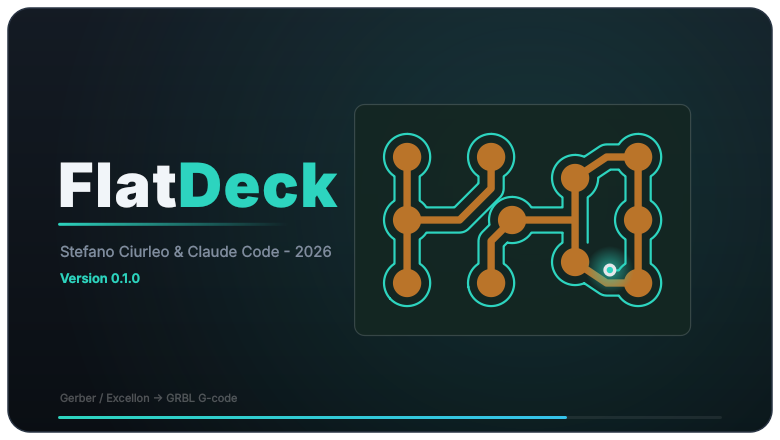
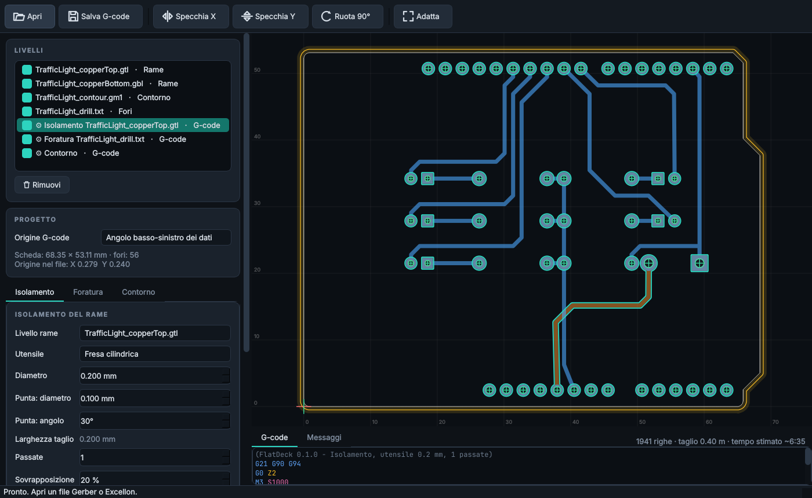

# FlatDeck

<p align="center"></p>

Turn **Gerber** and **Excellon** files into **GRBL 1.1 G-code** for milling printed circuit boards on a CNC (built around the CNC 1610 Pro).
A modern, minimal alternative to FlatCAM, which no longer runs on recent Ubuntu releases (Python 2 / PyQt4).
Same look and stack as [CNC Deck](https://github.com/stefanolmo/cncgrbl): Python 3 + Qt6 (PySide6), `numpy`, `pyclipper`.
Load the generated G-code in CNC Deck (or Candle, UGS…) to send it to the machine.

<p align="center"></p>

## Installation (Ubuntu)

```bash
./install.sh          # venv in ~/.local/share/flatdeck, "flatdeck" launcher, menu entry and desktop icon
flatdeck examples/TrafficLight_copperTop.gtl examples/TrafficLight_copperBottom.gbl examples/TrafficLight_contour.gm1 examples/TrafficLight_drill.txt
```

Without installing: `pip install -r requirements.txt && python3 -m flatdeck`.
Options: `--no-splash` (or `FLATDECK_NO_SPLASH=1`) skips the 3-second splash screen.

## Workflow

1. **Open** your files (several at once, or drag them onto the window): copper, outline, drill, silkscreen, mask. Layer type and side are
   recognised from the extension and the content (`.gtl/.gbl/.gm1/.gto/.gts…`); right-click a layer to change its type.
   Silkscreen and mask can be viewed but not milled.
2. **Double-sided boards**: generate the isolation of each copper layer. For the bottom one, tick *Bottom side: mirror in X*
   (off by default): the board is turned over about its own vertical axis. The same applies to drilling from the bottom side.
   (The *Mirror X/Y* and *Rotate* toolbar buttons, on the other hand, transform the whole project.)
3. The G-code **origin** is the lower-left corner of the **board outline** (or of the data, if there is no outline), identical on both
   sides: it is the point to zero on the machine (X0 Y0), before and after turning the board over.
4. In the **Isolation / Drilling / Cut-out** tabs set the parameters (they are remembered) and press *Generate*: every job appears in the
   layer list with a toolpath preview (the pale band is the tool width) and its G-code at the bottom.
5. **Save G-code…** saves the selected job.

| Operation | What it does |
|---|---|
| Isolation | copper offset with `pyclipper`; multiple passes with overlap; outside / inside / both; flat end mill or **V-bit** (cutting width computed from tip, angle and depth); toolpaths ordered by proximity |
| High voltage | wide copper-free band around selected copper islands (mains traces), cut with a large flat end mill (e.g. 2.5 or 3 mm) as a **separate job**; see below |
| Drilling | one job per file, selectable tools sorted by diameter, **M0 pause at every bit change**, optional peck drilling, slots (G85 and routed) |
| Cut-out | from the outline layer (closed profiles are chained, inner ones included) or from the data bounding box + margin; progressive depth passes; **tabs** (2 or 4) so the board does not come loose |
| Transforms | mirror X/Y, rotate 90°, all applied to the whole project |

**Narrow gaps.** Where two copper islands are closer than the tool diameter, the tool cannot pass between them without touching the
copper. FlatDeck then separates the two grooves by letting the tool cut into the copper edges, only as much as needed and at most half
a tool radius, and says so in the Messages tab. Gaps narrower than the tool radius cannot be isolated at all: they are shown in red in
the preview with a warning, and you need a smaller tool (or a V-bit at less depth) or a layout with more room.

G-code: only `G0 G1 G4 G21 G90 G94 M0 M2 M3 M5`, lines shorter than 80 characters, feed rate written only when it changes; the spindle starts
with `M3 S…` (S = 0 to omit it). Z is zeroed **on the copper surface**: depths are always positive in the interface.

## High-voltage clearance

A Gerber has no net names, so you pick the **islands** instead: an island is the copper connected together on one layer (pads and
traces of the same net). Open the **High voltage** tab, choose the copper layer, turn on *Pick islands in the view* and click the mains
traces (click again to unmark). Marked islands turn red. Mark the same net again on the other layer.

- *Clearance* is the width of the copper-free band measured from the edge of the HV copper; *Flat end mill Ø* is the bit used for it.
  The first pass is tangent to the copper, further passes (with the chosen overlap) widen the band until it reaches the clearance.
  With a 3 mm bit and a 3 mm clearance that is a single pass; the band can never be narrower than the bit (you get a warning).
- It is a **separate job** with its own bit and depth: zero Z again after the tool change. In the *Isolation* tab, *Skip islands marked
  high-voltage* (on by default) leaves those islands out of the fine isolation, so small traces keep their fine 0.2 mm isolation.
- If other copper lies inside the band it would be milled away: the job shows it in red and warns you. Fix the layout or reduce the
  clearance; FlatDeck does not move anything for you.
- **Which clearance is safe for your voltage is up to you and the applicable standard; FlatDeck only cuts the number you type.**
  A copper-free band is not a substitute for proper design of mains circuits.

## Limits of v1 (what is NOT there compared with FlatCAM)

- No copper clearing (NCC), no paint, no double-sided alignment holes, no auto-levelling, no sending to the machine.
- After a bit change you must **zero Z again** (no automatic probing).
- Gerber: aperture blocks (`AB`), aperture transforms (`LM/LR/LS`, ignored with a warning), the *moiré* macro and incremental
  coordinates are not supported. Non-round apertures used for draws are approximated by their convex hull. Macros (KiCad, Eagle,
  Altium) and step & repeat are supported.
- Excellon: repeat patterns (`R`) are ignored with a warning. Without `TZ/LZ` in the header trailing zeros are assumed to be
  omitted (it only matters when numbers have fewer digits than the format).
- Generation is synchronous: with many passes on large boards the interface may freeze for a few seconds.

**Test on the real machine with care**: the tests check geometry and G-code format, not the behaviour of the mill. Run the first job
with the bit raised (or without copper) and a hand on the emergency stop.

## Examples

`examples/TrafficLight_*` is a real double-sided board exported from **Fritzing** (68.35 × 53.11 mm, 56 holes, 4 bits, inches):
top and bottom copper, outline (5400 tiny segments, contiguous ones are merged into a single polyline), drill, mask and silkscreen.
A test checks that all 56 holes fall on a pad of both copper layers.
Not tried (yet) with Gerber files from KiCad, Eagle or EasyEDA.

## Layout

```
flatdeck/geom.py        polygons on Clipper: union, difference, offset, round-pen strokes, path ordering
flatdeck/gerber.py      RS-274X parser: apertures, macros, G74/G75 arcs, regions, polarity, step & repeat; outline chaining
flatdeck/excellon.py    Excellon parser: units, format/zeros, holes, slots
flatdeck/cam.py         isolation, high-voltage clearance, drilling, cut-out -> G-code
flatdeck/islands.py     connected copper islands, hit-testing (used to mark high-voltage copper)
flatdeck/model.py       project: layers, transforms, origin, board outline, HV marks (no Qt)
flatdeck/viewer.py      2D view (QPainter): pan, zoom, grid in mm from the origin
flatdeck/mainwindow.py  main window      flatdeck/splash.py  splash screen
```

## Development

```bash
pip install -e .[dev]
python -m pytest                                              # parsers, CAM, model, offscreen UI
QT_QPA_PLATFORM=offscreen python3 docs/make_screenshots.py    # regenerate the README images
```

Decisions not to change without a reason: geometry is float mm and Clipper works at 0.1 µm; the union is redone after every mirroring
(otherwise contour orientation flips and offsets go the wrong way); a line drawn with a round aperture is an `ET_OPENROUND`, not a
rectangle; the project `bounds` ignore the outline layer as long as there is other data, so the fit follows the copper.
