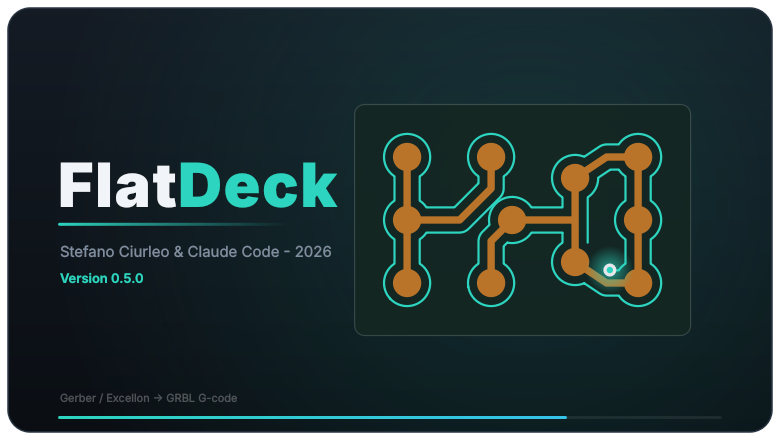
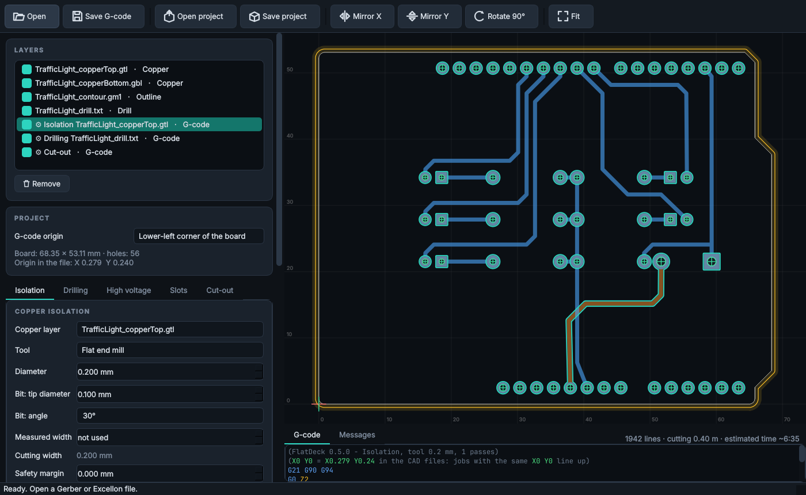
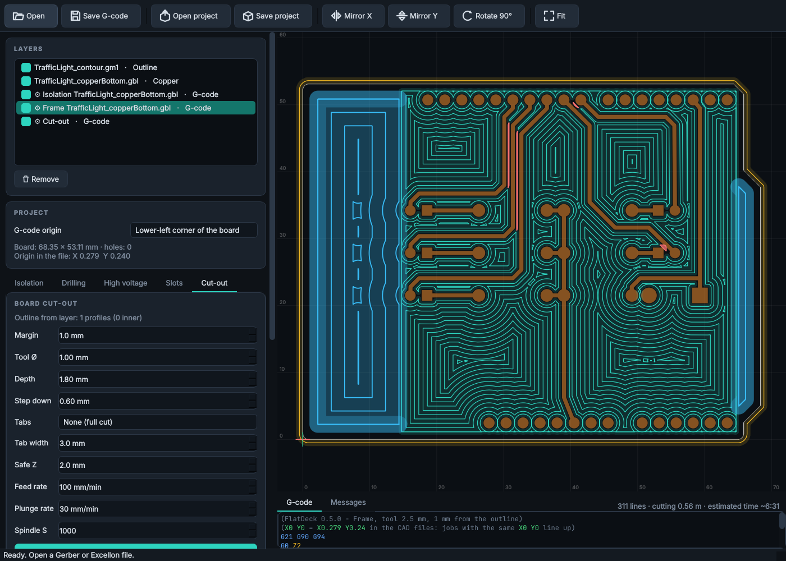
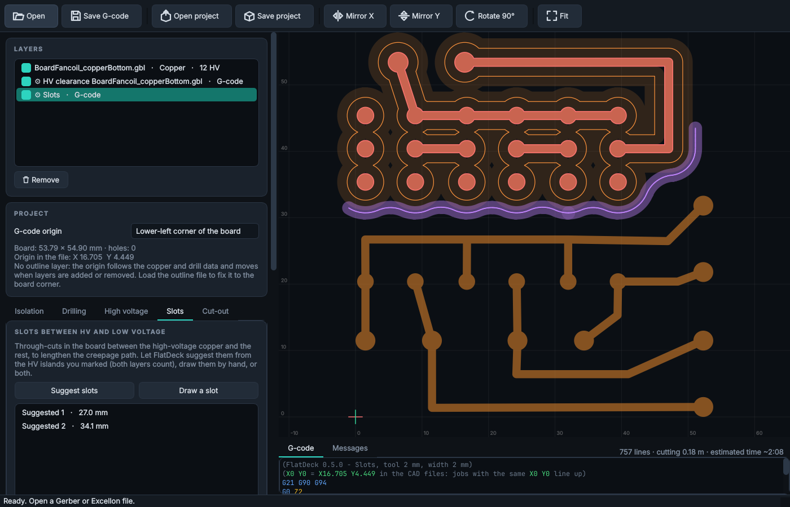

# FlatDeck

<p align="center"></p>

Turn **Gerber** and **Excellon** files into **GRBL 1.1 G-code** for milling printed circuit boards on a CNC (built around the CNC 1610 Pro).
A modern, minimal alternative to FlatCAM, which no longer runs on recent Ubuntu releases (Python 2 / PyQt4).
Same look and stack as [CNC Deck](https://github.com/stefanolmo/cncgrbl): Python 3 + Qt6 (PySide6), `numpy`, `pyclipper`.
Load the generated G-code in CNC Deck (or Candle, UGS…) to send it to the machine.

<p align="center"></p>

## Installation (Ubuntu)

```bash
./install.sh          # venv in ~/.local/share/flatdeck, "flatdeck" launcher, menu entry and desktop icon
flatdeck examples/TrafficLight_copperTop.gtl examples/TrafficLight_copperBottom.gbl examples/TrafficLight_contour.gm1 examples/TrafficLight_drill.txt
```

If the installer seems stuck: PySide6 is about 100 MB, so a slow connection looks like a freeze (a progress bar is shown). Run it with
`FLATDECK_VERBOSE=1 ./install.sh` to see every step; `FLATDECK_SKIP_APT=1` skips the `apt` step, `PYTHON=python3.12` picks another Python.
The package is built from a clean copy of the sources, so big folders next to them (such as a `.venv`) do not slow it down.

Without installing: `pip install -r requirements.txt && python3 -m flatdeck`.
Options: `--no-splash` (or `FLATDECK_NO_SPLASH=1`) skips the 3-second splash screen.

## Workflow

1. **Open** your files (several at once, or drag them onto the window): copper, outline, drill, silkscreen, mask. Layer type and side are
   recognised from the extension and the content (`.gtl/.gbl/.gm1/.gto/.gts…`); right-click a layer to change its type.
   Silkscreen and mask can be viewed but not milled.
2. **Double-sided boards**: generate the isolation of each copper layer. For the bottom one, tick *Bottom side: mirror in X*
   (off by default): the board is turned over about its own vertical axis. The same applies to drilling from the bottom side.
   (The *Mirror X/Y* and *Rotate* toolbar buttons, on the other hand, transform the whole project.)
3. The G-code **origin** is the lower-left corner of the **board outline** (or of the data, if there is no outline), identical on both
   sides: it is the point to zero on the machine (X0 Y0), before and after turning the board over.
   **Load the outline file too**: without it the origin follows the copper and drill data, so it moves when you add or remove layers.
   Every job remembers the origin it was generated with; jobs that no longer match the current one are marked *⚠ old origin*, FlatDeck
   warns when you save them, and *Regenerate jobs with the old origin* (Project card) rebuilds them with the same settings.
4. In the **Isolation / Drilling / Cut-out** tabs set the parameters (they are remembered) and press *Generate*: every job appears in the
   layer list with a toolpath preview (the pale band is the tool width) and its G-code at the bottom.
5. **Save G-code…** saves the selected job.

| Operation | What it does |
|---|---|
| Isolation | copper offset with `pyclipper`; multiple passes with overlap; outside / inside / both; flat end mill or **V-bit** (angle chosen from 10°–90° presets or typed freely; cutting width computed from tip, angle and depth); toolpaths ordered by proximity |
| High voltage | wide copper-free band around selected copper islands (mains traces), cut with a large flat end mill (e.g. 2.5 or 3 mm) as a **separate job**; see below |
| Slots | through-cuts in the board between high-voltage and low-voltage copper, suggested automatically from the marked HV islands and/or drawn by hand, flat end mill 1–3 mm (settable), no bridges; see below |
| Drilling | one job per file, selectable tools sorted by diameter, **M0 pause at every bit change**, optional peck drilling, slots (G85 and routed) |
| Cut-out | from the outline layer (closed profiles are chained, inner ones included) or from the data bounding box + margin; progressive depth passes; **tabs** (2 or 4) so the board does not come loose |
| Transforms | mirror X/Y, rotate 90°, all applied to the whole project |

**Enclosed copper islands.** Where the groove bands of neighbouring pads and traces overlap, they can close around a piece of clad
copper that belongs to nothing: the triangles and diamonds between four pads, the ring left around a pad inside a copper pour. They
stay on the board as floating copper. The option *Also clear enclosed copper islands* (Isolation tab, off by default) mills them away
with concentric passes, using the same tool and depth. It only works on copper that is completely enclosed by the grooves, it stays
tangent to the groove bands (so it never cuts into the traces, nor into the strip of copper left around them by the *Safety margin*),
and it needs the inside grooves (not available with *Outside only*). The Messages tab says how many islands were found and how many
passes were added. Example: on `examples/BoardFancoil_copperBottom.gbl` with a 2.5 mm tool and 0.2 mm margin, 16 islands (152.7 mm²)
are cleared with 20 extra passes: 8.6 → 11.8 min.

**Clearing all the copper around the circuit.** The alternative option *Clear all copper in a rectangle around the circuit* (also off by
default, mutually exclusive with the previous one) draws a rectangle whose sides touch the outer edge of the outermost grooves and
mills away **all** the clad copper inside it that is not circuit: traces, pads and their *Safety margin* strip are never touched, and
the copper outside the rectangle stays as it is. One loop runs along the four sides, the rest follow the edge of the copper still
to be removed, so nothing is milled twice. Cusps between the passes (specks of about 0.1 mm where two bands meet, dozens with a fine
tool) are cleared with a single plunge each. Limits: a round tool leaves the four corners of the rectangle slightly rounded, and with a
fine tool this takes a long time (a 0.8 mm tool on the same board: 1897 mm², about 53 min) (`examples/BoardFancoil_copperBottom.gbl`, 2.5 mm
tool, 0.2 mm margin: 840 mm² removed, 8.6 → 19.5 min; with a 0.4 mm tool the same board goes from 7.7 to about 85 min).

**Clearing the frame between the circuit and the board outline.** After isolation (even with the rectangle option) the copper between
the circuit and the board outline is a single floating conductor around everything. For a board with high-voltage tracks that matters: a
floating conductor in the path is not insulation, so the distance between HV and low-voltage copper through it is only the sum of two
small bare gaps. The card *Clear the frame around the circuit* (Cut-out tab) removes **all** that copper as a separate job with its
own bit (flat end mill, 2.5 mm by default: a big one needs no precision and takes minutes instead of hours), staying *Distance from
the outline* (1 mm) away from the cut line and from inner cut-outs, and never closer than one tool radius to the circuit and its
*Safety margin* strip, whatever the tool size. The circuit rectangle comes from the settings of the Isolation tab (tool, margin, passes
of the chosen layer), the same as for the *rectangle* option, so use the same values; the frame needs the outline file. Where the circuit
is closer to the outline than the keep-out no frame can be cleared and you get a warning (on `examples/TrafficLight_*` that is the case
at the top and bottom). Run it once per layer, mirrored for the bottom. Which distance is enough for your voltage is for you and the
standard to decide.

<p align="center"></p>
<p align="center"><sub>Teal: isolation with the rectangle option (0.8 mm tool); blue: the frame cleared with a 2.5 mm tool; yellow: the cut-out.</sub></p>

**Traces too thin?** The cutting width is computed from the bit data (V-bit: tip + 2 × depth × tan(angle / 2)); real bits rarely match it
exactly (the real tip is often wider than declared, wear, runout, a Z zero slightly too deep). Two controls in the Isolation tab:
*Measured width* (cut a test groove, measure it, type it: it replaces the computed width) and *Safety margin* (the groove is moved away
from the copper, so traces stay that much wider on each side; 0.02–0.05 mm is a typical start).

**Narrow gaps.** Where two copper islands are closer than the tool diameter, the tool cannot pass between them without touching the
copper. FlatDeck then separates the two grooves by letting the tool cut into the copper edges, only next to the gap, only as much as needed and at most half
a tool radius, and says so in the Messages tab. Gaps narrower than the tool radius cannot be isolated at all: they are shown in red in
the preview with a warning, and you need a smaller tool (or a V-bit at less depth) or a layout with more room.

G-code: only `G0 G1 G4 G21 G90 G94 M0 M2 M3 M5`, lines shorter than 80 characters, feed rate written only when it changes; the spindle starts
with `M3 S…` (S = 0 to omit it). Z is zeroed **on the copper surface**: depths are always positive in the interface.

## High-voltage clearance

A Gerber has no net names, so you pick the **islands** instead: an island is the copper connected together on one layer (pads and
traces of the same net). Open the **High voltage** tab, choose the copper layer, turn on *Pick islands in the view* and click the mains
traces (click again to unmark). Marked islands turn red. Mark the same net again on the other layer.

- *Clearance* is the width of the copper-free band measured from the edge of the HV copper; *Flat end mill Ø* is the bit used for it.
  The first pass is tangent to the copper, further passes (with the chosen overlap) widen the band until it reaches the clearance.
  With a 3 mm bit and a 3 mm clearance that is a single pass; the band can never be narrower than the bit (you get a warning).
- It is a **separate job** with its own bit and depth: zero Z again after the tool change. In the *Isolation* tab, *Skip islands marked
  high-voltage* (on by default) leaves those islands out of the fine isolation, so small traces keep their fine 0.2 mm isolation.
- If other copper lies inside the band it would be milled away: the job shows it in red and warns you. Fix the layout or reduce the
  clearance; FlatDeck does not move anything for you.
- **Which clearance is safe for your voltage is up to you and the applicable standard; FlatDeck only cuts the number you type.**
  A copper-free band is not a substitute for proper design of mains circuits.

## Slots between high-voltage and low-voltage copper

<p align="center"></p>
<p align="center"><sub>The upper part of the board is marked as high voltage: the orange loops are the copper-free band, the purple lines the suggested slots.</sub></p>

A slot cut through the board lengthens the creepage path between the two zones. Open the **Slots** tab:

- **Suggest slots from the HV islands** uses the islands you marked in the *High voltage* tab (on **both** copper layers: the slot cuts
  through the whole board). The HV zone is first treated as one shape (*Smooth HV outline*: the gaps between the pads of a row close,
  so the slot is a smooth line instead of a scallop around every pad). The slot centre line is the curve at *Offset from HV copper*
  from its edge, kept only where low-voltage copper is within *Reach to low voltage* of it, minus the stretches that would come
  closer than the *Keep-out from copper* to any copper (both layers) or hole, and cut at the board edge: a slot that reaches the
  edge leaves it open. **Offset and reach are automatic by default**: the offset is the middle of the narrowest gap between HV and
  low-voltage copper (at least tool radius + keep-out), the reach is twice that gap. The offset of a number you type has to leave the
  keep-out on both sides: for a 3 mm tool and a 0.5 mm keep-out in a 6.81 mm gap it has to be between 2.00 and 4.81 mm.
- **Nothing suggested?** The slot has to fit between the HV copper and the other copper: it needs the tool diameter plus the keep-out on
  each side. When it does not, FlatDeck tells you (message box and Messages tab) the narrowest gap it found and the largest tool that
  would fit, for example on `examples/BoardFancoil_copperBottom.gbl` with the upper part marked as HV the gap is 2.51 mm: a 2 mm tool
  needs 3.0 mm with the default 0.5 mm keep-out, so only a tool of up to 1.51 mm (or a smaller keep-out) fits. If only part of the edge
  has room it says how much, and names the parameter to change when the cause is the offset, the reach or the board outline. *Reach* is
  measured from the slot centre line to the low-voltage copper, not from the HV copper.
- **Draw a slot in the view**: click the points, double-click or Enter to finish, Escape to cancel. The ends snap to the board edge.
  Suggested and drawn slots live in one list (select one to highlight it, remove it, or clear all); a new suggestion replaces only
  the suggested ones.
- **Tool and width**: a flat end mill, any diameter (default 2 mm, meant for 1–3 mm). *Slot width* "as the tool" cuts one pass along
  the centre line, going back and forth down to the full depth without lifting; a larger width pockets the strip with concentric
  passes. Depth is board thickness + ~0.2 mm. The job needs its own bit: zero Z again after the tool change.
- **Checks**: red marks and a warning where a slot comes closer than the keep-out to copper or a hole, if part of it lies outside the
  board, or if it is narrower than 1 mm (standards often do not count the walls of a narrower slot for creepage).
- **No bridges are left.** A suggested curve that would close on itself is not suggested (it would cut the island out of the board): draw
  those by hand, leaving the island attached somewhere. Think about how the board is held while it is cut: a slot weakens it.

Which offset, width and distance are enough for your voltage is for you and the applicable standard to decide: FlatDeck cuts what you
set and checks only the geometry.

## Saving and opening a project

**Save project…** (toolbar) asks for a folder (the dialog has a **Save** button) and writes the work in progress into it. The button with
just the floppy symbol next to it, or `Ctrl+S`, saves straight into the folder of the current project, without asking (the first time,
when there is no folder yet, it asks like *Save project…*):

```
<your folder>/
  flatdeck-project.json     layers and jobs in the order of the layer list, origin choice, high-voltage marks, slots, transforms, all the parameters
  files/                    a COPY of every Gerber / Excellon file that was loaded
  jobs/                     every job already generated: 01_<name>.nc (the G-code, exactly what "Save G-code" writes) and 01_<name>.npz (toolpaths for the preview)
```

The project is therefore self-contained: it keeps working if the original files are moved or deleted, and from then on FlatDeck uses
its own copies. **Open project…** reads such a folder back (after asking before it replaces the current work) and restores the layers,
the generated jobs (isolation, drilling, cut-out, HV band, slots, frame: with their G-code, preview, warnings and red marks), the HV
marks, the slots, every setting of the tabs (including the bits you ticked in *Drilling*), the selected layer and the open tab; the
settings of the project do not overwrite your own defaults. Saving again to the same folder just updates it (jobs you removed
disappear from `jobs/`); another folder that already holds a project, or is not empty, asks first.

A restored job keeps its G-code and preview, but it carries no recipe to be made again: if you later change the circuit so that
its origin moves, the job is marked *⚠ old origin* and has to be generated again from its tab (the settings are restored, so it is one
click). A project folder is treated as untrusted data: it can only name files inside itself, and the toolpath files are read without
pickle.

## Limits of v1 (what is NOT there compared with FlatCAM)

- No copper clearing (NCC), no paint, no double-sided alignment holes, no auto-levelling, no sending to the machine.
- After a bit change you must **zero Z again** (no automatic probing).
- Gerber: aperture blocks (`AB`), aperture transforms (`LM/LR/LS`, ignored with a warning), the *moiré* macro and incremental
  coordinates are not supported. Non-round apertures used for draws are approximated by their convex hull. Macros (KiCad, Eagle,
  Altium) and step & repeat are supported.
- Excellon: repeat patterns (`R`) are ignored with a warning. Without `TZ/LZ` in the header trailing zeros are assumed to be
  omitted (it only matters when numbers have fewer digits than the format).
- Generation is synchronous: with many passes on large boards the interface may freeze for a few seconds.

**Test on the real machine with care**: the tests check geometry and G-code format, not the behaviour of the mill. Run the first job
with the bit raised (or without copper) and a hand on the emergency stop.

## Examples

`examples/TrafficLight_*` is a real double-sided board exported from **Fritzing** (68.35 × 53.11 mm, 56 holes, 4 bits, inches):
top and bottom copper, outline (5400 tiny segments, contiguous ones are merged into a single polyline), drill, mask and silkscreen.
A test checks that all 56 holes fall on a pad of both copper layers.
Not tried (yet) with Gerber files from KiCad, Eagle or EasyEDA.

## Layout

```
flatdeck/geom.py        polygons on Clipper: union, difference, offset, round-pen strokes, path ordering
flatdeck/gerber.py      RS-274X parser: apertures, macros, G74/G75 arcs, regions, polarity, step & repeat; outline chaining
flatdeck/excellon.py    Excellon parser: units, format/zeros, holes, slots
flatdeck/cam.py         isolation, high-voltage clearance, drilling, cut-out -> G-code
flatdeck/islands.py     connected copper islands, hit-testing (used to mark high-voltage copper)
flatdeck/model.py       project: layers, transforms, origin, board outline, HV marks (no Qt)
flatdeck/viewer.py      2D view (QPainter): pan, zoom, grid in mm from the origin
flatdeck/mainwindow.py  main window      flatdeck/splash.py  splash screen
```

## Development

```bash
pip install -e .[dev]
python -m pytest                                              # parsers, CAM, model, offscreen UI
QT_QPA_PLATFORM=offscreen python3 docs/make_screenshots.py    # regenerate the README images
```

Decisions not to change without a reason: geometry is float mm and Clipper works at 0.1 µm; the union is redone after every mirroring
(otherwise contour orientation flips and offsets go the wrong way); a line drawn with a round aperture is an `ET_OPENROUND`, not a
rectangle; the project `bounds` ignore the outline layer as long as there is other data, so the fit follows the copper.
